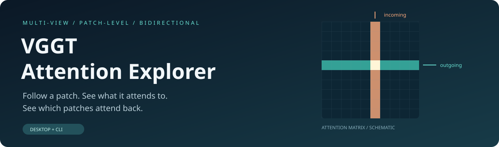

<div align="center">



**Pick a patch. See where it attends across views.**

[中文说明](README.zh-CN.md) · [Quick start](#quick-start) · [Usage](docs/usage.md) · [How it works](#reading-the-maps) · [Validation](docs/validation.md)

[](https://github.com/Glupayy/VGGT-Image-Seq-Attention/actions/workflows/ci.yml)

[](https://github.com/facebookresearch/vggt)
[](LICENSE.txt)

</div>

A research visualization tool built on [VGGT](https://github.com/facebookresearch/vggt) (CVPR 2025). Explore a selected patch's global attention in both directions, with an interactive desktop viewer or a headless export command. This repository is an independent extension of VGGT.

- **Three ways to look.** A query spotlight, sparse target links, or raw outgoing / incoming maps.
- **Clear query context.** A marked source patch and enlarged crop make the selection visible.
- **Preserved probabilities.** Spotlight uses a labeled rank cutoff; raw overlays share one linear scale.
- **Capture once, explore repeatedly.** Cache a selected layer's head-mean matrix on CPU; clicks reuse it.
- **Inspect the numbers.** CLI exports a PNG, compressed numeric arrays, and JSON provenance together.
- **Reproducible checks.** Numeric references, model-parity checks, coordinate tests, and offline exports run without pretrained weights.

## Real pretrained examples


**Flower center across three views.** Amber marks the query; cyan marks each target view's highest outgoing attention. These are real official VGGT-1B results, `global_block_11`, all 16 heads averaged. Lines visualize attention targets, not independently verified geometric matches.


**Change the query, watch the spotlight change.** The two LEGO frames reuse the same model forward. Patches above the 90th percentile within each target view retain their color; other pixels are dimmed. Raw attention is preserved.

[More examples and display guide](docs/showcase.md) · [Numerical validation](docs/assets/showcase/validation.json) · [Sample sources](examples/README.md)

## Quick start

Use Python 3.10 or newer. Install a matching PyTorch / torchvision pair for your hardware using the [official selector](https://pytorch.org/get-started/locally/), then:

```bash
git clone https://github.com/Glupayy/VGGT-Image-Seq-Attention.git
cd VGGT-Image-Seq-Attention
python -m venv .venv
source .venv/bin/activate
# Install torch and torchvision in this environment first.
python -m pip install -e '.[dev]'
```

### Try an offline fixture

```bash
vggt-attention --demo --output outputs/demo.png
```

This uses a deterministic, randomly initialized tiny VGGT aggregator and synthetic images. It checks the entire capture → extraction → plot → export path; it is **not** a pretrained VGGT-1B result.

### Explore your images

```bash
vggt-attention-gui
# Equivalent source entry:
python -m vggt.attention_gui
```

Select 1–6 related views, run attention capture, then click a patch. Switch the display between `spotlight`, `links` and `raw`; both clicks and style changes reuse the cache. The default layer is `global_block_11`. The viewer loads the model lazily and keeps the interface responsive while inference runs.

The default model is [`facebook/VGGT-1B`](https://huggingface.co/facebook/VGGT-1B), downloaded on first real inference. CUDA is used when available, otherwise CPU. CPU inference works but the full model is substantial. The GUI needs Tkinter and a graphical session; use the CLI on a headless machine. See [installation and troubleshooting](docs/package.md).

### Export a specific patch

```bash
vggt-attention examples/images/flower/000.png examples/images/flower/006.png \
  examples/images/flower/012.png --source 0 --patch 14 25 --layer 11 \
  --style links --top-k 1 --output outputs/flower.png
```

All indices are zero-based. `--patch ROW COL` refers to the **preprocessed** image grid, not original image pixels. Omit `--patch` to select its center. To use a local checkpoint:

```bash
vggt-attention examples/images/lego/00.png --model ./VGGT-1B \
  --device cpu --output outputs/local.png
```

Each export contains:

| File | Contents |
| --- | --- |
| `attention.png` | Selected display style; default `spotlight` |
| `attention.npz` | `outgoing`, `incoming` arrays `[views, patch_rows, patch_cols]`; preprocessed RGB `images` |
| `attention.json` | Model ID or local path, input paths, patch, layer, head selection, device, and cache geometry |

Use `--style spotlight --top-percent 10` for a rank-based focus view, `--style links --top-k 3` for spaced raw attention peaks, or `--style raw` for paired outgoing / incoming overlays. The NPZ probabilities are identical across display styles.

## Reading the maps

For each head, the tool captures `A = softmax(Q Kᵀ / √d)` **after Q/K normalization and 2D RoPE**, before dropout. It averages the selected heads. The default includes all heads; `--max-heads K` deliberately uses only the first K and records that choice.

For selected token `i`:

| Direction | Slice | Question |
| --- | --- | --- |
| Outgoing | `A[i, :]` | What does this patch attend to? |
| Incoming | `A[:, i]` | Which tokens attend to this patch? |

The full outgoing row sums to one. A column generally does not. Camera/register tokens participate in the softmax, but overlays show only image patches, so visible outgoing mass may sum to less than one. Incoming maps are **not** normalized again. Attention weights describe this layer's routing; they do not establish a causal explanation or a geometric correspondence by themselves.

## Implementation

Unobserved layers use PyTorch scaled dot-product attention. For a selected layer, query chunks reconstruct probabilities in float32, average heads, and transfer one `[B, 1, N, N]` matrix to CPU. This bounds temporary attention allocations while retaining fast repeated patch selection. The persistent CPU cache still costs `4 × B × N²` bytes per layer.

Geometry comes from each actual forward pass: batch, view count, patch dimensions, and special-token offset. Caches belong to individual models and are refreshed on every forward. CLI and GUI capture `global_block_11` by default; the core API retains `global_block_23` as its compatibility default. Visualization entries run the aggregator without reconstruction heads.

```python
import torch
from vggt.models.vggt_vis import VGGT
from vggt.utils.load_fn import load_and_preprocess_images

model = VGGT.from_pretrained("facebook/VGGT-1B", strict=True).eval()
images = load_and_preprocess_images(["view_a.jpg", "view_b.jpg"])
model.enable_attention_caching(["global_block_23"])
with torch.inference_mode():
    model.aggregator(images[None])
data = model.extract_patch_attention(0, 13, 17, "global_block_23")
```

## Validation and project map

```bash
python -m pytest -q
python -m build
```

[Validation notes](docs/validation.md) describe the tested environment, numerical checks, and real-model verification. GitHub Actions runs CPU tests and builds on Python 3.10 and 3.12 after publication; the badge reflects the remote workflow state.

| Directory | Purpose |
| --- | --- |
| [`vggt/`](vggt/) | Model, attention capture, rendering, CLI and desktop viewer |
| [`examples/`](examples/README.md) | Multi-view inputs and per-file source records |
| [`scripts/`](scripts/) | Gallery generation, numerical validation and frame sampling |
| [`tests/`](tests/) | Offline numerical, interface and export checks |
| [`docs/`](docs/usage.md) | Usage, installation, display guide and validation records |
| [`archive/`](archive/README.md) | Historical demos, notebooks, figures and research notes |

Current fixes and tests target the desktop and CLI entries in `vggt/`. Historical material is grouped under `archive/`. The original upstream introduction is preserved in [the upstream notes](docs/upstream-vggt.md).

## Attribution and license

Built on the work of Jianyuan Wang, Minghao Chen, Nikita Karaev, Andrea Vedaldi, Christian Rupprecht, and David Novotny. Preserve the upstream notices and [repository license](LICENSE.txt), CC BY-NC 4.0. Model weights retain their [upstream terms](https://huggingface.co/facebook/VGGT-1B). No model weights are committed here.

```bibtex
@inproceedings{wang2025vggt,
  title={VGGT: Visual Geometry Grounded Transformer},
  author={Wang, Jianyuan and Chen, Minghao and Karaev, Nikita and Vedaldi, Andrea and Rupprecht, Christian and Novotny, David},
  booktitle={Proceedings of the IEEE/CVF Conference on Computer Vision and Pattern Recognition},
  year={2025}
}
```
