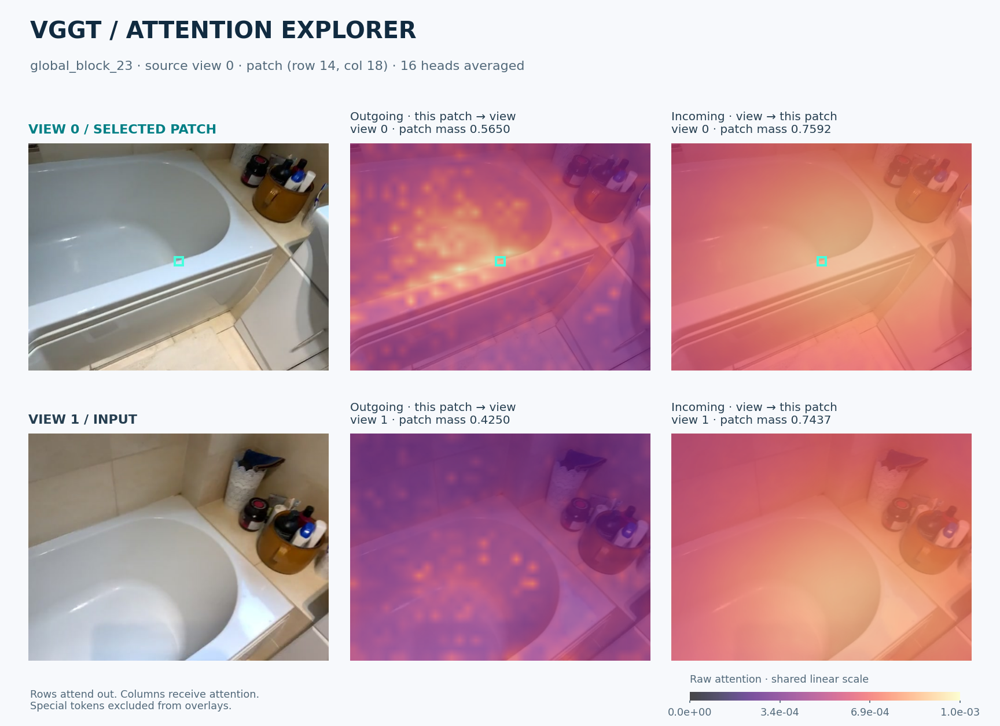

# VGGT Attention Explorer

[English](README.md) · [验证记录](docs/validation.md) · [安装与排障](docs/package.md)

点击一个图像 patch，同时查看它在多视图中的**出向 attention（关注哪里）**和**入向 attention（谁关注它）**。本项目是在上游 [VGGT](https://github.com/facebookresearch/vggt) 基础上开发的独立研究可视化工具。



上图来自官方完整权重的真实 CPU 推理，使用第 23 个 global block、全部 16 个 heads 和统一线性色标。[原始数值](docs/assets/bathroom-attention.npz) · [验证指标](docs/assets/pretrained-validation.json)。

## 安装

需要 Python 3.10+。在虚拟环境中先按照 [PyTorch 官方说明](https://pytorch.org/get-started/locally/) 安装适合硬件的 torch / torchvision 组合，再安装本项目：

```bash
git clone https://github.com/Glupayy/vggt_attn.git
cd vggt_attn
python -m venv .venv
source .venv/bin/activate
# 先在此环境安装匹配的 torch 和 torchvision
python -m pip install -e '.[dev]'
```

## 使用

无需下载权重的端到端演示：

```bash
vggt-attention --demo --output outputs/demo.png
```

它使用固定随机种子的微型 VGGT aggregator 和合成图像，只用于验证程序流程，**不是预训练 VGGT-1B 的实验结果**。

桌面交互：

```bash
vggt-attention-gui
```

选择 1–6 张相关图像，运行一次模型，再点击 patch 探索。默认只缓存 `global_block_23`，平均全部 attention heads。模型首次推理会从官方 `facebook/VGGT-1B` 下载；有 CUDA 时自动使用 CUDA，否则使用 CPU。桌面入口需要 Tkinter 和图形会话。

命令行导出：

```bash
vggt-attention temp_images/image_000.jpg temp_images/image_005.jpg \
  --source 0 --patch 14 18 --layer 23 --output outputs/attention.png
```

`--source` 与 `--patch 行 列` 均从 0 开始，坐标指向**预处理后**的 patch 网格。省略 `--patch` 默认选择中心。可用 `--model ./VGGT-1B` 载入本地目录，`--max-heads K` 只平均前 K 个 heads。

输出包含配套的 `.png` 图、`.npz` 原始出向/入向数值与预处理 RGB 图像、`.json` 模型/输入/层/坐标/heads/缓存信息。

## 如何理解图

对归一化、2D RoPE 后的 Q/K，取 `A = softmax(QKᵀ / √d)`，再平均各 head。

| 方向 | 读取方式 | 含义 |
| --- | --- | --- |
| 出向 | `A[i, :]` | 选中 patch 对其他 token 的关注 |
| 入向 | `A[:, i]` | 其他 token 对选中 patch 的关注 |

完整行的和为 1；列不要求和为 1。图上仅显示图像 patch，camera/register tokens 仍参与 softmax，因此可见的出向权重之和可能小于 1。程序不会二次归一化入向权重，所有图默认共享线性色标。Attention 可用于观察该层的信息路由，不单独构成因果解释或几何对应的证明。

缓存每个模型独立，每次推理更新真实 batch、帧数、网格和特殊 token 偏移。计算按 query 分块，CPU 保存 head 均值；持久缓存仍为每层 `4 × B × N²` 字节，大量图像会增加内存。

## 验证与历史资料

```bash
python -m pytest -q
python -m build
```

详见 [验证记录](docs/validation.md)。当前维护 Tkinter 与 CLI 入口；旧 OpenCV/hook 脚本与 notebook 保留作历史参考。[位置编码研究](research/README.md) 和 [开发归档](docs/archive/README.md) 单独保存，研究脚本中的模拟 attention 不作为真实模型证据。

保留上游贡献者署名与 [CC BY-NC 4.0 许可证](LICENSE.txt)。权重遵循官方仓库条款，不提交到本仓库。
