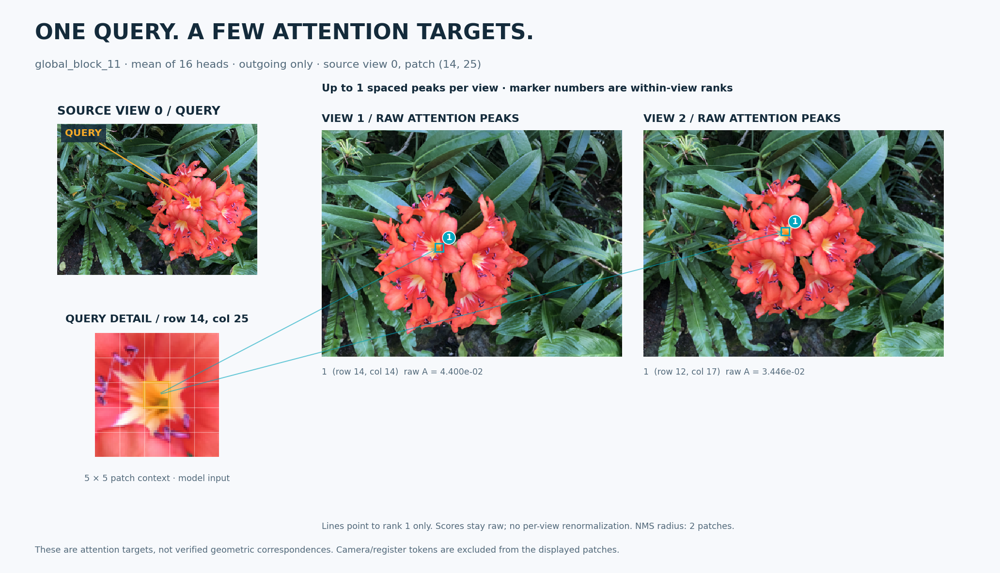
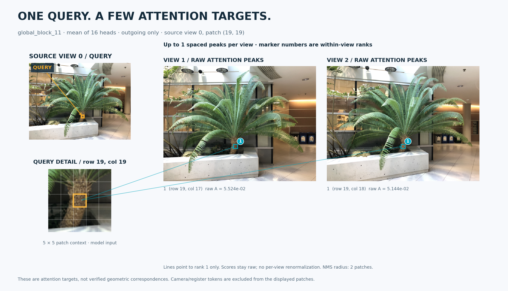
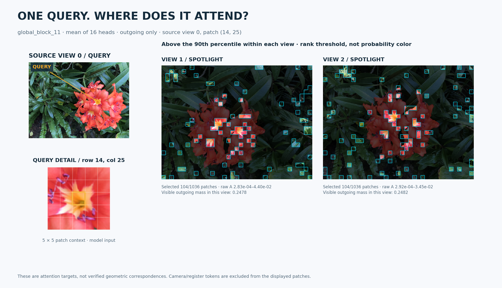
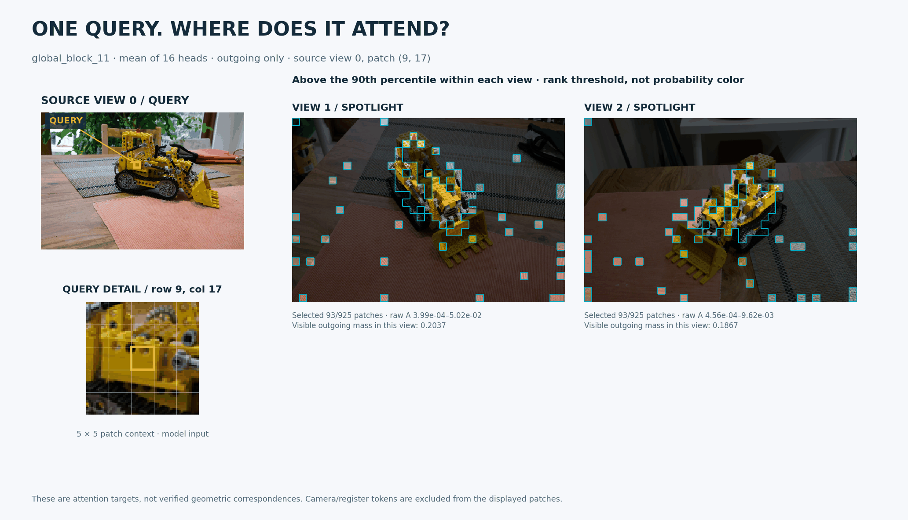

# A clearer view of patch attention

The gallery uses three real views per scene from the official VGGT examples:
flowers, a LEGO bulldozer, and a potted fern. Original image bytes and per-file
hashes are recorded in [the sample manifest](../sample_images/SOURCES.json).
The figures use the official VGGT-1B checkpoint, CPU float32, global block 11
(zero-based), and the arithmetic mean of all 16 heads.

## Sparse attention targets



Amber is the selected patch. Its 5 × 5 patch context is enlarged below the
source image. Cyan marks the raw outgoing-attention maximum in each other view;
lines join the actual patch centers. Here the maxima land on the flower center
in both target images despite its changing image position.

The gallery sets `--top-k 1` for a clear first view. The CLI default is three
spaced peaks per target. Additional peaks use greedy suppression of a 5 × 5
patch neighborhood; their numbers are ranks within that view. Some secondary
peaks land at image boundaries. Lines express attention routing, not measured
geometric correspondence.



## Query spotlight



The spotlight leaves patches strictly above the 90th percentile of attention
within each target view in their original color and dims other pixels to 34%
brightness. Cyan boundaries follow the patch grid. The figure prints raw score
ranges and the full visible outgoing mass in each target view. The percentile
is a display threshold, not a probability scale or a segmentation mask.
Uniform maps receive no arbitrary highlight.



The LEGO animation alternates between source patch `(9, 17)` (cabin) and
`(14, 29)` (bucket), using the same cached forward. The change is visible without
rerunning the model. The bucket example is more diffuse than the flower query;
the gallery preserves that behavior.

## Raw analysis and curation

`--style raw` retains the original shared-scale outgoing/incoming comparison.
The CLI and GUI default to block 11 because it shows more interpretable local
structure in these curated scenes than the diffuse last-layer head mean.
You can select any block from 0 through 23. The underlying cache API keeps its
previous block-23 default.

These queries were chosen by visual inspection after exploring layers and
subjects. They illustrate behavior, not general matching accuracy. Different
queries can attend to boundaries, repeated objects, or unrelated regions.
All heads remain included. No attention values are retouched, normalized per
view, or replaced with simulated correspondences.

## Reproduce and inspect

After installing the project and obtaining the official local checkpoint:

```bash
python scripts/generate_showcase.py --model ./VGGT-1B \
  --output outputs/showcase --threads 4
```

This loads weights with `strict=True`, runs the full aggregator with capture
off/on for each scene, compares all 24 outputs, and verifies every displayed
query's full outgoing row and incoming column against an independent reference:
QKV, Q/K normalization and RoPE are recomputed in the model's float32 dtype;
QK products, softmax and full-row denominators then use float64. Camera and
register tokens remain in each denominator. Prediction heads are skipped.

[Validation JSON](assets/showcase/validation.json) records checkpoint SHA256,
input paths, query coordinates, raw target scores, display transforms and
numeric checks. Raw maps, preprocessed inputs, and full reference vectors:
[flower](assets/showcase/flower-center.npz),
[LEGO cabin](assets/showcase/lego-cabin.npz),
[LEGO bucket](assets/showcase/lego-bucket.npz),
[fern](assets/showcase/fern-trunk.npz).

Export one query through the installed CLI:

```bash
vggt-attention sample_images/flower/000.png sample_images/flower/006.png \
  sample_images/flower/012.png --model ./VGGT-1B --device cpu \
  --layer 11 --patch 14 25 --style links --top-k 1 \
  --output outputs/flower.png
```

Change `--style` to `spotlight` or `raw`. PNG rendering changes; the exported
`outgoing`, `incoming`, and `images` arrays stay the same.
